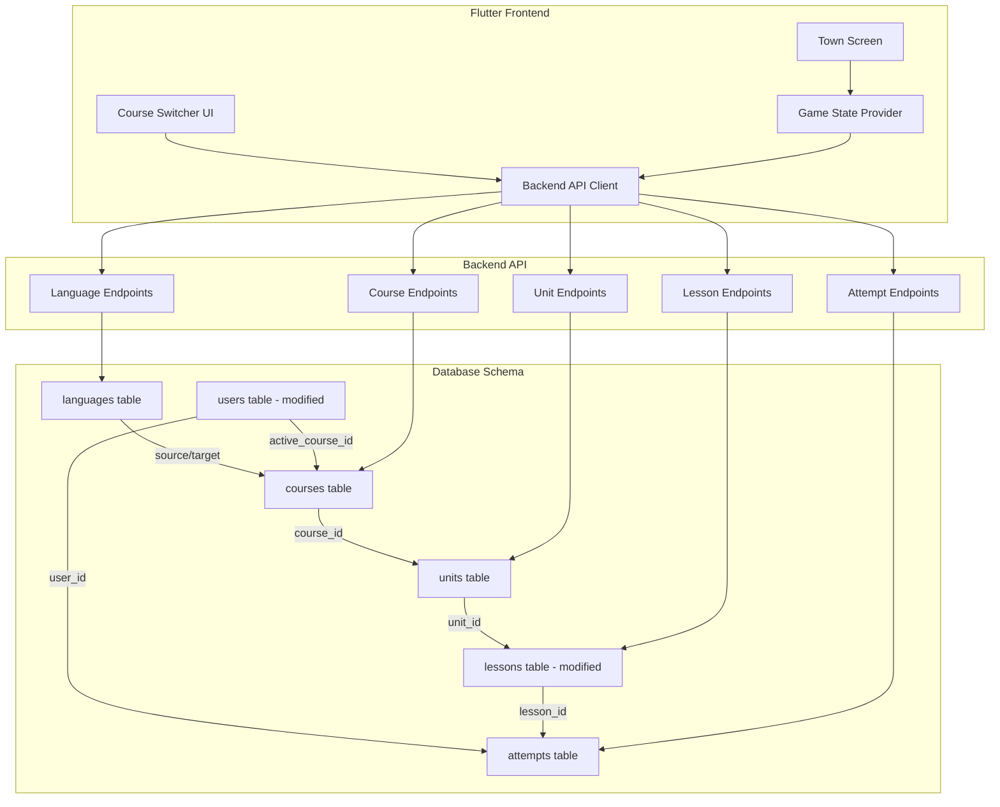
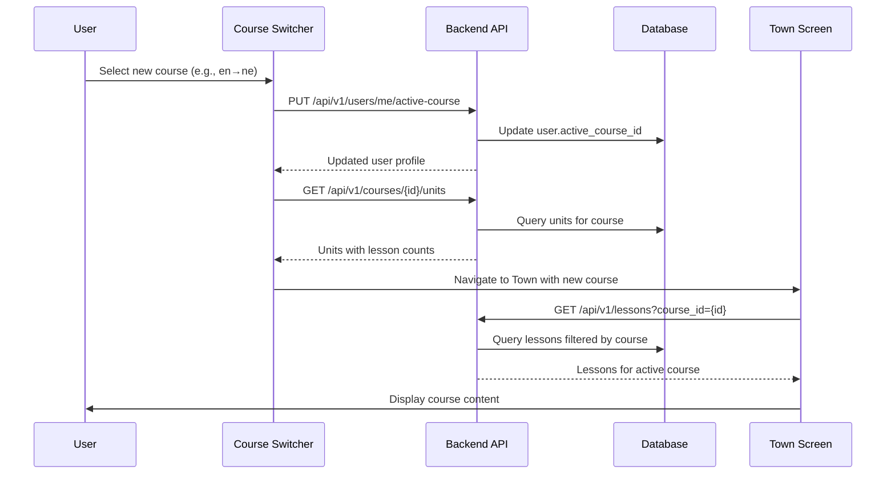

# Design Document: Multi-Language Course Architecture

## Overview

This design implements a comprehensive multi-language course system for the Glossa language learning app, transforming it from a single-direction language learner into a full bidirectional course platform. The system introduces explicit learning directions (e.g., English→Nepali vs Nepali→English), course management, and unit-based lesson organization while preserving all existing user data and lesson history.

The architecture supports three languages (English, Nepali, Newari) with six possible learning directions, introduces a hierarchical course→unit→lesson structure, and implements safe migration strategies to protect existing content and user progress.

## Architecture



## Main Algorithm/Workflow



## Database Schema Design

### New Tables

#### languages Table

```python
class Language(Base):
    __tablename__ = "languages"
    
    id: Mapped[str] = mapped_column(String(10), primary_key=True)  # 'en', 'ne', 'new'
    name_english: Mapped[str] = mapped_column(String(80))  # 'English', 'Nepali', 'Newari'
    name_native: Mapped[str] = mapped_column(String(80))  # 'English', 'नेपाली', 'नेवारी'
    script: Mapped[str] = mapped_column(String(40))  # 'Latin', 'Devanagari', 'Devanagari'
    is_active: Mapped[bool] = mapped_column(Boolean, default=True)
    
    # Relationships
    courses_as_source: Mapped[list["Course"]] = relationship(
        foreign_keys="Course.source_language_id",
        back_populates="source_language"
    )
    courses_as_target: Mapped[list["Course"]] = relationship(
        foreign_keys="Course.target_language_id",
        back_populates="target_language"
    )
```

**Preconditions:**
- `id` is a valid ISO 639 language code or standard abbreviation
- `name_english` and `name_native` are non-empty strings
- `script` identifies the writing system used

**Postconditions:**
- Language record uniquely identifies a supported language
- Both source and target course relationships are maintained bidirectionally

#### courses Table

```python
class Course(Base):
    __tablename__ = "courses"
    
    id: Mapped[str] = mapped_column(String(40), primary_key=True)  # 'en_ne', 'ne_en', etc.
    source_language_id: Mapped[str] = mapped_column(ForeignKey("languages.id"))
    target_language_id: Mapped[str] = mapped_column(ForeignKey("languages.id"))
    name: Mapped[str] = mapped_column(String(120))  # 'English → Nepali'
    description: Mapped[str | None] = mapped_column(String(500), nullable=True)
    is_published: Mapped[bool] = mapped_column(Boolean, default=False)
    created_at: Mapped[datetime] = mapped_column(DateTime(timezone=True), server_default=func.now())
    
    # Relationships
    source_language: Mapped["Language"] = relationship(
        foreign_keys=[source_language_id],
        back_populates="courses_as_source"
    )
    target_language: Mapped["Language"] = relationship(
        foreign_keys=[target_language_id],
        back_populates="courses_as_target"
    )
    units: Mapped[list["Unit"]] = relationship(back_populates="course", cascade="all, delete-orphan")
    active_users: Mapped[list["User"]] = relationship(back_populates="active_course")
```

**Preconditions:**
- `source_language_id` and `target_language_id` exist in languages table
- `source_language_id` ≠ `target_language_id` (cannot learn a language from itself)
- `id` format follows convention: `{source}_{target}` (e.g., 'en_ne')

**Postconditions:**
- Course represents a unique learning direction
- `is_published` controls visibility to users (unpublished = "Coming Soon")
- All units belong to exactly one course

#### units Table

```python
class Unit(Base):
    __tablename__ = "units"
    
    id: Mapped[int] = mapped_column(primary_key=True)
    course_id: Mapped[str] = mapped_column(ForeignKey("courses.id", ondelete="CASCADE"), index=True)
    sequence: Mapped[int] = mapped_column(Integer)  # Display order within course
    title: Mapped[str] = mapped_column(String(120))  # 'World 1: Home & Food'
    description: Mapped[str | None] = mapped_column(String(500), nullable=True)
    
    # Relationships
    course: Mapped["Course"] = relationship(back_populates="units")
    lessons: Mapped[list["Lesson"]] = relationship(back_populates="unit", cascade="all, delete-orphan")
    
    __table_args__ = (
        UniqueConstraint("course_id", "sequence", name="uq_course_sequence"),
    )
```

**Preconditions:**
- `course_id` references an existing course
- `sequence` is a positive integer unique within the course
- `title` is a non-empty descriptive string

**Postconditions:**
- Units are ordered by sequence within each course
- All lessons belong to exactly one unit
- Deleting a course cascades to delete its units and lessons

**Loop Invariants:**
- When iterating units by sequence: all previously seen units have `sequence < current_sequence`
- Unit sequence numbers remain unique within course throughout iteration

### Modified Tables

#### lessons Table (Modified)

```python
class Lesson(Base):
    __tablename__ = "lessons"
    
    id: Mapped[str] = mapped_column(String(40), primary_key=True)
    unit_id: Mapped[int] = mapped_column(ForeignKey("units.id", ondelete="CASCADE"), index=True)  # NEW
    sequence: Mapped[int] = mapped_column(Integer)  # NEW - order within unit
    title: Mapped[str] = mapped_column(String(120))
    subtitle: Mapped[str] = mapped_column(String(200))
    exercise_type: Mapped[str] = mapped_column(String(40))
    xp_reward: Mapped[int] = mapped_column(Integer, default=20)
    word_count: Mapped[int] = mapped_column(Integer, default=4)
    required_level: Mapped[int] = mapped_column(Integer, default=1)
    is_published: Mapped[bool] = mapped_column(Boolean, default=False)  # NEW
    
    # Relationships
    unit: Mapped["Unit"] = relationship(back_populates="lessons")  # NEW
    exercises: Mapped[list["Exercise"]] = relationship(back_populates="lesson", cascade="all, delete-orphan")
    attempts: Mapped[list["Attempt"]] = relationship(back_populates="lesson")  # NEW
    
    __table_args__ = (
        UniqueConstraint("unit_id", "sequence", name="uq_unit_sequence"),  # NEW
    )
```

**Migration Changes:**
- Add `unit_id` column (nullable initially for migration safety)
- Add `sequence` column (nullable initially)
- Add `is_published` column (default False)
- Add unique constraint on (unit_id, sequence)
- Add relationship to Unit

**Preconditions:**
- `unit_id` references an existing unit
- `sequence` is unique within the unit
- `is_published` determines lesson visibility

**Postconditions:**
- Existing lessons are preserved in a legacy unit
- Lesson ordering is now explicit via sequence
- Unpublished lessons can exist without breaking user experience

#### users Table (Modified)

```python
class User(Base):
    __tablename__ = "users"
    
    id: Mapped[int] = mapped_column(primary_key=True)
    name: Mapped[str] = mapped_column(String(80))
    email: Mapped[str] = mapped_column(String(320), unique=True, index=True)
    password_hash: Mapped[str] = mapped_column(String(255))
    hero_index: Mapped[int] = mapped_column(Integer, default=0)
    hero_class_name: Mapped[str] = mapped_column(String(40), default="Traveler")
    language_id: Mapped[str] = mapped_column(String(40), default="newari")  # DEPRECATED but kept for backward compat
    active_course_id: Mapped[str | None] = mapped_column(ForeignKey("courses.id"), nullable=True, index=True)  # NEW
    xp: Mapped[int] = mapped_column(Integer, default=0)
    level: Mapped[int] = mapped_column(Integer, default=1)
    streak: Mapped[int] = mapped_column(Integer, default=0)
    last_activity_date: Mapped[date | None] = mapped_column(nullable=True)
    words_found: Mapped[int] = mapped_column(Integer, default=0)
    lessons_completed: Mapped[int] = mapped_column(Integer, default=0)
    
    # Relationships
    attempts: Mapped[list["Attempt"]] = relationship(back_populates="user")
    active_course: Mapped["Course | None"] = relationship(back_populates="active_users")  # NEW
```

**Migration Changes:**
- Add `active_course_id` column (nullable, indexed)
- Add foreign key constraint to courses table
- Keep `language_id` for backward compatibility during transition
- Add relationship to Course

**Preconditions:**
- `active_course_id` is null or references an existing course
- If null, user has not selected a course yet
- `language_id` remains for backward compatibility

**Postconditions:**
- User's current learning course is explicitly tracked
- Progress is isolated per course (via lesson→unit→course chain)
- Global metrics (XP, streak, level) are preserved across course switches

## Components and Interfaces

### Backend Components

#### LanguageManager
**Purpose**: Manages language data and course mappings

**Interface**:
```python
class LanguageManager:
    def get_languages() -> list[Language]
    def get_courses(published_only: bool) -> list[Course]
    def get_course_by_id(course_id: str) -> Course | None
```

**Responsibilities**:
- Retrieve language and course data from database
- Filter courses by published status
- Provide course lookup functionality

#### CourseProgressTracker
**Purpose**: Tracks user progress within courses and calculates lesson statuses

**Interface**:
```python
class CourseProgressTracker:
    def get_units_for_course(course_id: str, user_id: int) -> list[Unit]
    def calculate_lesson_statuses(course_id: str, user_id: int) -> dict[str, str]
    def get_cleared_lesson_count(unit_id: int, user_id: int) -> int
```

**Responsibilities**:
- Load units with progress information
- Calculate lesson statuses (cleared/current/locked) per course
- Aggregate completion statistics

#### MigrationExecutor
**Purpose**: Executes database schema migrations safely

**Interface**:
```python
class MigrationExecutor:
    def upgrade() -> None
    def downgrade() -> None
    def validate_migration() -> bool
```

**Responsibilities**:
- Create new tables and modify existing ones
- Preserve existing data during migration
- Validate foreign key relationships

### Flutter Components

#### CourseSwitcher
**Purpose**: UI component for selecting and switching between courses

**Interface**:
```dart
class CourseSwitcher extends StatelessWidget {
  Widget build(BuildContext context)
  void onCourseSelected(String courseId)
}
```

**Responsibilities**:
- Display available courses with source/target languages
- Show published status ("Available" vs "Coming Soon")
- Trigger course switch via GameStateNotifier
- Navigate to Town screen after switch

#### TownScreen (Modified)
**Purpose**: Display course content with unit headers and lesson cards

**Modifications**:
- Replace hardcoded "World 1: Home & Food" with dynamic unit titles
- Group lessons by unit
- Filter lessons by active course

**Interface**:
```dart
class TownScreen extends ConsumerWidget {
  Widget build(BuildContext context, WidgetRef ref)
  List<Widget> buildUnitSections(List<Unit> units, List<Lesson> lessons)
}
```

**Responsibilities**:
- Render unit headers with progress indicators
- Display lessons grouped by unit
- Maintain existing navigation and animations

#### GameStateNotifier (Modified)
**Purpose**: Manages application state including course selection

**New Methods**:
```dart
class GameStateNotifier extends StateNotifier<GameState> {
  Future<void> switchCourse(String courseId) async
  Future<void> loadCoursesAndLanguages() async
  Future<void> loadUnitsForActiveCourse() async
}
```

**Responsibilities**:
- Load and cache courses and languages
- Switch user's active course
- Reload units and lessons when course changes
- Preserve global progress (XP, streak, level)

## Data Models

### Backend Data Models

#### Language Model

```python
class Language(Base):
    __tablename__ = "languages"
    
    id: Mapped[str] = mapped_column(String(10), primary_key=True)
    name_english: Mapped[str] = mapped_column(String(80))
    name_native: Mapped[str] = mapped_column(String(80))
    script: Mapped[str] = mapped_column(String(40))
    is_active: Mapped[bool] = mapped_column(Boolean, default=True)
```

**Validation Rules**:
- `id` must be 2-10 character language code
- `name_english` and `name_native` must be non-empty
- `script` must be one of: Latin, Devanagari, Cyrillic, Arabic (extensible)

#### Course Model

```python
class Course(Base):
    __tablename__ = "courses"
    
    id: Mapped[str] = mapped_column(String(40), primary_key=True)
    source_language_id: Mapped[str] = mapped_column(ForeignKey("languages.id"))
    target_language_id: Mapped[str] = mapped_column(ForeignKey("languages.id"))
    name: Mapped[str] = mapped_column(String(120))
    description: Mapped[str | None] = mapped_column(String(500), nullable=True)
    is_published: Mapped[bool] = mapped_column(Boolean, default=False)
    created_at: Mapped[datetime] = mapped_column(DateTime(timezone=True), server_default=func.now())
```

**Validation Rules**:
- `id` format: `{source}_{target}` (e.g., 'en_ne')
- `source_language_id` ≠ `target_language_id`
- `source_language_id` and `target_language_id` must exist in languages table
- `name` follows format: "{Source} → {Target}"

#### Unit Model

```python
class Unit(Base):
    __tablename__ = "units"
    
    id: Mapped[int] = mapped_column(primary_key=True)
    course_id: Mapped[str] = mapped_column(ForeignKey("courses.id", ondelete="CASCADE"), index=True)
    sequence: Mapped[int] = mapped_column(Integer)
    title: Mapped[str] = mapped_column(String(120))
    description: Mapped[str | None] = mapped_column(String(500), nullable=True)
    
    __table_args__ = (
        UniqueConstraint("course_id", "sequence", name="uq_course_sequence"),
    )
```

**Validation Rules**:
- `sequence` must be positive integer
- `sequence` must be unique within course
- `title` must be non-empty
- Cascading delete: deleting course removes all units

#### Modified Lesson Model

```python
class Lesson(Base):
    __tablename__ = "lessons"
    
    # Existing fields preserved
    id: Mapped[str] = mapped_column(String(40), primary_key=True)
    title: Mapped[str] = mapped_column(String(120))
    subtitle: Mapped[str] = mapped_column(String(200))
    exercise_type: Mapped[str] = mapped_column(String(40))
    xp_reward: Mapped[int] = mapped_column(Integer, default=20)
    word_count: Mapped[int] = mapped_column(Integer, default=4)
    required_level: Mapped[int] = mapped_column(Integer, default=1)
    
    # New fields
    unit_id: Mapped[int] = mapped_column(ForeignKey("units.id", ondelete="CASCADE"), index=True)
    sequence: Mapped[int] = mapped_column(Integer)
    is_published: Mapped[bool] = mapped_column(Boolean, default=False)
    
    __table_args__ = (
        UniqueConstraint("unit_id", "sequence", name="uq_unit_sequence"),
    )
```

**Validation Rules**:
- All existing validation rules preserved
- `unit_id` must reference existing unit
- `sequence` must be unique within unit
- `is_published` controls visibility in API responses

#### Modified User Model

```python
class User(Base):
    __tablename__ = "users"
    
    # Existing fields preserved
    id: Mapped[int] = mapped_column(primary_key=True)
    name: Mapped[str] = mapped_column(String(80))
    email: Mapped[str] = mapped_column(String(320), unique=True, index=True)
    password_hash: Mapped[str] = mapped_column(String(255))
    hero_index: Mapped[int] = mapped_column(Integer, default=0)
    hero_class_name: Mapped[str] = mapped_column(String(40), default="Traveler")
    xp: Mapped[int] = mapped_column(Integer, default=0)
    level: Mapped[int] = mapped_column(Integer, default=1)
    streak: Mapped[int] = mapped_column(Integer, default=0)
    last_activity_date: Mapped[date | None] = mapped_column(nullable=True)
    words_found: Mapped[int] = mapped_column(Integer, default=0)
    lessons_completed: Mapped[int] = mapped_column(Integer, default=0)
    
    # Deprecated but kept for backward compatibility
    language_id: Mapped[str] = mapped_column(String(40), default="newari")
    
    # New field
    active_course_id: Mapped[str | None] = mapped_column(
        ForeignKey("courses.id"), 
        nullable=True, 
        index=True
    )
```

**Validation Rules**:
- All existing validation rules preserved
- `active_course_id` must be null or reference existing course
- If `active_course_id` is set, must reference published course (API level validation)

### Flutter Data Models

#### Language Model

```dart
class Language {
  final String id;
  final String nameEnglish;
  final String nameNative;
  final String script;
  final bool isActive;

  const Language({
    required this.id,
    required this.nameEnglish,
    required this.nameNative,
    required this.script,
    required this.isActive,
  });
  
  factory Language.fromJson(Map<String, dynamic> json) {
    return Language(
      id: json['id'] as String,
      nameEnglish: json['name_english'] as String,
      nameNative: json['name_native'] as String,
      script: json['script'] as String,
      isActive: json['is_active'] as bool,
    );
  }
}
```

#### Course Model

```dart
class Course {
  final String id;
  final String sourceLanguageId;
  final String targetLanguageId;
  final String name;
  final String? description;
  final bool isPublished;
  final Language sourceLanguage;
  final Language targetLanguage;

  const Course({
    required this.id,
    required this.sourceLanguageId,
    required this.targetLanguageId,
    required this.name,
    this.description,
    required this.isPublished,
    required this.sourceLanguage,
    required this.targetLanguage,
  });
  
  factory Course.fromJson(Map<String, dynamic> json) {
    return Course(
      id: json['id'] as String,
      sourceLanguageId: json['source_language_id'] as String,
      targetLanguageId: json['target_language_id'] as String,
      name: json['name'] as String,
      description: json['description'] as String?,
      isPublished: json['is_published'] as bool,
      sourceLanguage: Language.fromJson(json['source_language']),
      targetLanguage: Language.fromJson(json['target_language']),
    );
  }
}
```

#### Unit Model

```dart
class Unit {
  final int id;
  final String courseId;
  final int sequence;
  final String title;
  final String? description;
  final int totalLessons;
  final int clearedLessons;

  const Unit({
    required this.id,
    required this.courseId,
    required this.sequence,
    required this.title,
    this.description,
    required this.totalLessons,
    required this.clearedLessons,
  });
  
  factory Unit.fromJson(Map<String, dynamic> json) {
    return Unit(
      id: (json['id'] as num).toInt(),
      courseId: json['course_id'] as String,
      sequence: (json['sequence'] as num).toInt(),
      title: json['title'] as String,
      description: json['description'] as String?,
      totalLessons: (json['total_lessons'] as num).toInt(),
      clearedLessons: (json['cleared_lessons'] as num).toInt(),
    );
  }
  
  double get progress => totalLessons > 0 ? clearedLessons / totalLessons : 0.0;
}
```

#### Modified Lesson Model

```dart
class Lesson {
  // Existing fields preserved
  final String id;
  final String title;
  final String subtitle;
  final ExerciseType exerciseType;
  final LessonStatus status;
  final int xpReward;
  final int wordCount;
  final int requiredLevel;
  
  // New fields
  final int unitId;
  final int sequence;
  final bool isPublished;

  const Lesson({
    required this.id,
    required this.unitId,
    required this.sequence,
    required this.title,
    required this.subtitle,
    required this.exerciseType,
    required this.status,
    this.xpReward = 20,
    this.wordCount = 4,
    this.requiredLevel = 1,
    this.isPublished = true,
  });
  
  factory Lesson.fromJson(Map<String, dynamic> json) {
    return Lesson(
      id: json['id'] as String,
      unitId: (json['unit_id'] as num).toInt(),
      sequence: (json['sequence'] as num).toInt(),
      title: json['title'] as String,
      subtitle: json['subtitle'] as String,
      exerciseType: _parseExerciseType(json['exercise_type']),
      status: _parseStatus(json['status']),
      xpReward: (json['xp_reward'] as num?)?.toInt() ?? 20,
      wordCount: (json['word_count'] as num?)?.toInt() ?? 4,
      requiredLevel: (json['required_level'] as num?)?.toInt() ?? 1,
      isPublished: (json['is_published'] as bool?) ?? true,
    );
  }
}
```

## Core Interfaces/Types

### Backend API Schemas

```python
# Language schemas
class LanguageOut(BaseModel):
    id: str
    name_english: str
    name_native: str
    script: str
    is_active: bool

# Course schemas
class CourseOut(BaseModel):
    id: str
    source_language_id: str
    target_language_id: str
    name: str
    description: str | None
    is_published: bool
    source_language: LanguageOut
    target_language: LanguageOut

class CourseUpdate(BaseModel):
    active_course_id: str

# Unit schemas
class UnitOut(BaseModel):
    id: int
    course_id: str
    sequence: int
    title: str
    description: str | None
    total_lessons: int
    cleared_lessons: int

# Modified lesson schemas
class LessonOut(BaseModel):
    id: str
    unit_id: int
    sequence: int
    title: str
    subtitle: str
    exercise_type: str
    status: str  # 'cleared', 'current', 'locked'
    xp_reward: int
    word_count: int
    required_level: int
    is_published: bool
```

### Flutter Models

```dart
// New models
class Language {
  final String id;
  final String nameEnglish;
  final String nameNative;
  final String script;
  final bool isActive;

  const Language({
    required this.id,
    required this.nameEnglish,
    required this.nameNative,
    required this.script,
    required this.isActive,
  });
}

class Course {
  final String id;
  final String sourceLanguageId;
  final String targetLanguageId;
  final String name;
  final String? description;
  final bool isPublished;
  final Language sourceLanguage;
  final Language targetLanguage;

  const Course({
    required this.id,
    required this.sourceLanguageId,
    required this.targetLanguageId,
    required this.name,
    this.description,
    required this.isPublished,
    required this.sourceLanguage,
    required this.targetLanguage,
  });
}

class Unit {
  final int id;
  final String courseId;
  final int sequence;
  final String title;
  final String? description;
  final int totalLessons;
  final int clearedLessons;

  const Unit({
    required this.id,
    required this.courseId,
    required this.sequence,
    required this.title,
    this.description,
    required this.totalLessons,
    required this.clearedLessons,
  });
}

// Modified DemoUser
class DemoUser {
  // ... existing fields ...
  final String? activeCourseId;  // NEW
  
  const DemoUser({
    // ... existing parameters ...
    this.activeCourseId,
  });
}

// Modified GameState
class GameState {
  // ... existing fields ...
  final String? activeCourseId;  // NEW
  final List<Language> languages;  // NEW
  final List<Course> courses;  // NEW
  final List<Unit> units;  // NEW
  
  const GameState({
    // ... existing parameters ...
    this.activeCourseId,
    this.languages = const [],
    this.courses = const [],
    this.units = const [],
  });
}
```

## Key Functions with Formal Specifications

### Database Migration: upgrade()

```python
def upgrade():
    """Execute forward migration to multi-language course architecture."""
    pass  # See Algorithmic Pseudocode section
```

**Preconditions:**
- Database is at migration version 0002_user_activity_date
- All users have valid `language_id` values
- All lessons and attempts exist in current schema

**Postconditions:**
- Four new tables created: languages, courses, units
- Lessons table has unit_id, sequence, is_published columns
- Users table has active_course_id column
- All existing lessons preserved in legacy unit
- All existing users have valid active_course_id
- No attempt records lost or corrupted

**Loop Invariants:**
- During user backfill: all processed users have valid active_course_id
- During lesson migration: all lessons maintain original ID and content

### Backend API: get_courses()

```python
@app.get("/api/v1/courses")
def get_courses(
    published_only: bool = True,
    db: Session = Depends(db_session),
    user: User = Depends(current_user)
) -> list[CourseOut]:
    """List all available courses, optionally filtered by published status."""
    pass
```

**Preconditions:**
- User is authenticated
- Database contains at least one language and one course

**Postconditions:**
- Returns list of courses with source/target language details
- If `published_only=True`, returns only courses with `is_published=True`
- If `published_only=False`, returns all courses (for admin use)
- Courses include full language objects (nested data)

### Backend API: get_units_for_course()

```python
@app.get("/api/v1/courses/{course_id}/units")
def get_units_for_course(
    course_id: str,
    db: Session = Depends(db_session),
    user: User = Depends(current_user)
) -> list[UnitOut]:
    """Get all units for a specific course with progress information."""
    pass
```

**Preconditions:**
- User is authenticated
- `course_id` references an existing course

**Postconditions:**
- Returns units ordered by sequence
- Each unit includes total_lessons count
- Each unit includes cleared_lessons count for the current user
- cleared_lessons is calculated from attempts table

### Backend API: update_active_course()

```python
@app.put("/api/v1/users/me/active-course")
def update_active_course(
    payload: CourseUpdate,
    db: Session = Depends(db_session),
    user: User = Depends(current_user)
) -> UserOut:
    """Update the user's active course selection."""
    pass
```

**Preconditions:**
- User is authenticated
- `payload.active_course_id` references an existing course
- Course must have `is_published=True`

**Postconditions:**
- User's `active_course_id` is updated in database
- Returns updated user profile
- Subsequent lesson queries will filter by new course

### Backend API: get_lessons() - Modified

```python
@app.get("/api/v1/lessons")
def get_lessons(
    course_id: str | None = None,
    db: Session = Depends(db_session),
    user: User = Depends(current_user)
) -> list[LessonOut]:
    """Get lessons, optionally filtered by course."""
    pass
```

**Preconditions:**
- User is authenticated
- If `course_id` provided, it references an existing course
- User has an active_course_id or course_id parameter is provided

**Postconditions:**
- If `course_id` provided, returns lessons only from that course's units
- If `course_id` not provided, uses user's active_course_id
- Only published lessons are returned
- Lesson status ('cleared'/'current'/'locked') calculated per course
- Lessons ordered by unit.sequence, then lesson.sequence

**Loop Invariants:**
- When calculating statuses: all previously processed lessons maintain their status
- Status assignment ensures only one 'current' lesson per course

### Flutter: switchCourse()

```dart
Future<void> switchCourse(String courseId) async {
  """Switch the user's active course and reload relevant data."""
}
```

**Preconditions:**
- `courseId` references a valid, published course
- User is authenticated
- Backend API is reachable

**Postconditions:**
- User's active_course_id updated in backend
- GameState.activeCourseId updated
- GameState.units loaded for new course
- GameState.lessons loaded for new course
- Town screen displays new course content
- User's global progress (XP, level, streak) unchanged
- Previous course progress preserved (can switch back)

## Algorithmic Pseudocode

### Database Migration Algorithm

```pascal
ALGORITHM upgrade_to_multi_language_courses
INPUT: none (reads current database state)
OUTPUT: none (modifies database schema and data)

BEGIN
  // Step 1: Create new tables
  CREATE TABLE languages (
    id VARCHAR(10) PRIMARY KEY,
    name_english VARCHAR(80) NOT NULL,
    name_native VARCHAR(80) NOT NULL,
    script VARCHAR(40) NOT NULL,
    is_active BOOLEAN DEFAULT TRUE
  )
  
  CREATE TABLE courses (
    id VARCHAR(40) PRIMARY KEY,
    source_language_id VARCHAR(10) REFERENCES languages(id),
    target_language_id VARCHAR(10) REFERENCES languages(id),
    name VARCHAR(120) NOT NULL,
    description VARCHAR(500),
    is_published BOOLEAN DEFAULT FALSE,
    created_at TIMESTAMP DEFAULT NOW()
  )
  
  CREATE TABLE units (
    id SERIAL PRIMARY KEY,
    course_id VARCHAR(40) REFERENCES courses(id) ON DELETE CASCADE,
    sequence INTEGER NOT NULL,
    title VARCHAR(120) NOT NULL,
    description VARCHAR(500),
    UNIQUE(course_id, sequence)
  )
  
  // Step 2: Modify existing tables
  ADD COLUMN lessons.unit_id INTEGER REFERENCES units(id) ON DELETE CASCADE
  ADD COLUMN lessons.sequence INTEGER
  ADD COLUMN lessons.is_published BOOLEAN DEFAULT FALSE
  ADD UNIQUE CONSTRAINT lessons(unit_id, sequence)
  
  ADD COLUMN users.active_course_id VARCHAR(40) REFERENCES courses(id)
  CREATE INDEX idx_users_active_course ON users(active_course_id)
  
  // Step 3: Seed languages
  INSERT INTO languages VALUES
    ('en', 'English', 'English', 'Latin', TRUE),
    ('ne', 'Nepali', 'नेपाली', 'Devanagari', TRUE),
    ('new', 'Newari', 'नेवारी', 'Devanagari', TRUE)
  
  // Step 4: Seed courses (all six directions)
  course_configs ← [
    ('new_en', 'new', 'en', 'Newari → English', FALSE),
    ('new_ne', 'new', 'ne', 'Newari → Nepali', FALSE),
    ('en_new', 'en', 'new', 'English → Newari', FALSE),
    ('en_ne', 'en', 'ne', 'English → Nepali', FALSE),
    ('ne_new', 'ne', 'new', 'Nepali → Newari', FALSE),
    ('ne_en', 'ne', 'en', 'Nepali → English', FALSE)
  ]
  
  FOR EACH config IN course_configs DO
    INSERT INTO courses (id, source_language_id, target_language_id, name, is_published)
    VALUES config
  END FOR
  
  // Step 5: Create legacy unit for existing lessons
  // Note: We don't auto-assign to new_en because exercise content needs verification
  legacy_course_id ← 'new_en'  // Placeholder, but mark unpublished
  
  INSERT INTO units (course_id, sequence, title, description) 
  VALUES (legacy_course_id, 1, 'Legacy Content', 'Original lessons - under review')
  
  legacy_unit_id ← LAST_INSERT_ID()
  
  // Step 6: Migrate existing lessons to legacy unit
  existing_lessons ← SELECT id FROM lessons ORDER BY id
  
  FOR EACH lesson IN existing_lessons WITH INDEX i DO
    UPDATE lessons 
    SET unit_id = legacy_unit_id,
        sequence = i + 1,
        is_published = FALSE  // Mark as draft until verified
    WHERE id = lesson.id
  END FOR
  
  // Step 7: Backfill user active courses based on language_id
  existing_users ← SELECT id, language_id FROM users
  
  FOR EACH user IN existing_users DO
    CASE user.language_id
      WHEN 'newari' THEN course ← 'new_en'
      WHEN 'nepali' THEN course ← 'ne_en'
      WHEN 'english' THEN course ← 'en_ne'
      ELSE course ← 'new_en'  // Default fallback
    END CASE
    
    UPDATE users 
    SET active_course_id = course 
    WHERE id = user.id
  END FOR
  
  // Step 8: Make unit_id NOT NULL now that all lessons have values
  ALTER TABLE lessons ALTER COLUMN unit_id SET NOT NULL
  ALTER TABLE lessons ALTER COLUMN sequence SET NOT NULL
  
  ASSERT all_lessons_have_unit: SELECT COUNT(*) FROM lessons WHERE unit_id IS NULL = 0
  ASSERT all_users_have_course: SELECT COUNT(*) FROM users WHERE active_course_id IS NULL = 0
  ASSERT no_attempts_lost: SELECT COUNT(*) FROM attempts = original_attempt_count
END
```

**Preconditions:**
- Database schema is at version 0002
- All existing lessons have valid IDs
- All users have valid language_id values
- No foreign key violations exist in current schema

**Postconditions:**
- Three languages exist in database
- Six courses exist (all initially unpublished)
- One legacy unit exists containing all original lessons
- All lessons have unit_id, sequence, and is_published=False
- All users have valid active_course_id
- All attempt history preserved and queryable
- Schema constraints are enforced (NOT NULL, UNIQUE, FK)

**Loop Invariants:**
- During lesson migration: all processed lessons have valid unit_id and sequence
- During user backfill: all processed users have valid active_course_id
- Original lesson IDs and attempt records remain unchanged throughout

### Lesson Status Calculation Algorithm

```pascal
ALGORITHM calculate_lesson_statuses_for_course
INPUT: user_id, course_id
OUTPUT: map of lesson_id to status ('cleared', 'current', 'locked')

BEGIN
  // Get all lessons for the course, ordered by unit then lesson sequence
  lessons ← SELECT l.id 
            FROM lessons l
            JOIN units u ON l.unit_id = u.id
            WHERE u.course_id = course_id 
              AND l.is_published = TRUE
            ORDER BY u.sequence, l.sequence
  
  // Get all cleared lessons for this user in this course
  cleared_lesson_ids ← SELECT a.lesson_id 
                       FROM attempts a
                       JOIN lessons l ON a.lesson_id = l.id
                       JOIN units u ON l.unit_id = u.id
                       WHERE a.user_id = user_id 
                         AND u.course_id = course_id
  
  statuses ← {}
  previous_cleared ← TRUE
  found_current ← FALSE
  
  FOR EACH lesson IN lessons DO
    IF lesson.id IN cleared_lesson_ids THEN
      statuses[lesson.id] ← 'cleared'
      previous_cleared ← TRUE
    ELSE IF previous_cleared AND NOT found_current THEN
      statuses[lesson.id] ← 'current'
      previous_cleared ← FALSE
      found_current ← TRUE
    ELSE
      statuses[lesson.id] ← 'locked'
      previous_cleared ← FALSE
    END IF
  END FOR
  
  RETURN statuses
END
```

**Preconditions:**
- `user_id` references an existing user
- `course_id` references an existing course
- All lessons in the course are properly sequenced
- Attempt records are accurate

**Postconditions:**
- Returns status for every published lesson in the course
- Exactly one lesson has status 'current' (unless all cleared or none cleared)
- All lessons before 'current' have status 'cleared'
- All lessons after 'current' have status 'locked'
- Unpublished lessons are excluded from results

**Loop Invariants:**
- At any point in iteration: all lessons before current index follow cleared → current → locked progression
- Once `found_current` is TRUE, no subsequent lesson can be 'current'
- `previous_cleared` accurately reflects whether previous lesson was cleared

### Course Switching Algorithm (Flutter)

```pascal
ALGORITHM switch_course
INPUT: new_course_id
OUTPUT: none (updates GameState)

BEGIN
  ASSERT new_course_id IS NOT NULL
  ASSERT user is authenticated
  
  // Step 1: Update backend
  state ← state.copyWith(isLoading: TRUE, clearError: TRUE)
  
  TRY
    // Update user's active course
    updated_user ← api.updateActiveCourse(new_course_id)
    
    // Load new course data
    units ← api.getUnitsForCourse(new_course_id)
    lessons ← api.getLessons(courseId: new_course_id)
    
    // Step 2: Update GameState
    IF mounted THEN
      state ← state.copyWith(
        user: updated_user,
        activeCourseId: new_course_id,
        units: units,
        lessons: lessons,
        isLoading: FALSE,
        clearActiveLesson: TRUE,  // Reset any active lesson
        exercises: []
      )
    END IF
    
    // Step 3: Navigate to Town screen if not already there
    navigate_to_town()
    
  CATCH error
    IF mounted THEN
      state ← state.copyWith(
        isLoading: FALSE,
        errorMessage: error.toString()
      )
    END IF
    RETHROW error
  END TRY
  
  ASSERT state.activeCourseId = new_course_id
  ASSERT state.lessons contains only lessons from new course
  ASSERT state.user.xp is unchanged (global progress preserved)
END
```

**Preconditions:**
- User is authenticated
- `new_course_id` references a published course
- Backend API is reachable
- User has network connectivity

**Postconditions:**
- User's `active_course_id` updated in backend
- GameState contains lessons only from new course
- GameState contains units only from new course
- Any active lesson session is cleared
- User's global XP, level, and streak are unchanged
- Previous course progress is preserved (accessible on switch back)

## Example Usage

### Migration Execution

```bash
# Backend developer runs migration
cd backend
alembic upgrade head

# Output:
# INFO  [alembic.runtime.migration] Running upgrade 0002 -> 0003, multi_language_courses
# INFO  [alembic.runtime.migration] Creating languages table
# INFO  [alembic.runtime.migration] Creating courses table
# INFO  [alembic.runtime.migration] Creating units table
# INFO  [alembic.runtime.migration] Migrating 7 existing lessons to legacy unit
# INFO  [alembic.runtime.migration] Backfilling active_course_id for 7 users
```

### Backend API Usage

```python
# List all published courses
GET /api/v1/courses
Authorization: Bearer <token>

Response 200:
[
  {
    "id": "new_en",
    "source_language_id": "new",
    "target_language_id": "en",
    "name": "Newari → English",
    "description": null,
    "is_published": true,
    "source_language": {
      "id": "new",
      "name_english": "Newari",
      "name_native": "नेवारी",
      "script": "Devanagari",
      "is_active": true
    },
    "target_language": {
      "id": "en",
      "name_english": "English",
      "name_native": "English",
      "script": "Latin",
      "is_active": true
    }
  },
  {
    "id": "en_ne",
    "name": "English → Nepali",
    "is_published": false,
    ...
  }
]

# Get units for a course
GET /api/v1/courses/new_en/units
Authorization: Bearer <token>

Response 200:
[
  {
    "id": 1,
    "course_id": "new_en",
    "sequence": 1,
    "title": "World 1: Home & Food",
    "description": "Learn basic vocabulary for daily life",
    "total_lessons": 7,
    "cleared_lessons": 3
  },
  {
    "id": 2,
    "sequence": 2,
    "title": "World 2: Travel & Places",
    "total_lessons": 5,
    "cleared_lessons": 0
  }
]

# Update user's active course
PUT /api/v1/users/me/active-course
Authorization: Bearer <token>
Content-Type: application/json

{
  "active_course_id": "en_ne"
}

Response 200:
{
  "id": 1,
  "name": "Alice",
  "active_course_id": "en_ne",
  "xp": 450,
  "level": 3,
  ...
}

# Get lessons for active course
GET /api/v1/lessons
Authorization: Bearer <token>

Response 200:
[
  {
    "id": "en_ne_1_1",
    "unit_id": 5,
    "sequence": 1,
    "title": "Greetings",
    "status": "cleared",
    "is_published": true,
    ...
  },
  {
    "id": "en_ne_1_2",
    "unit_id": 5,
    "sequence": 2,
    "title": "Numbers",
    "status": "current",
    ...
  }
]
```

### Flutter Usage

```dart
// Switch course from Course Switcher UI
await ref.read(gameStateProvider.notifier).switchCourse('en_ne');

// GameState updates:
// - activeCourseId: 'en_ne'
// - units: [Unit(id: 5, title: 'Basics', ...), ...]
// - lessons: [Lesson(id: 'en_ne_1_1', ...), ...]
// - User XP/level/streak unchanged

// Town screen automatically displays new course content
// Units displayed as headers: "World 1: Basics"
// Lessons filtered to show only en_ne lessons
// Progress is independent per course
```

## Correctness Properties

*A property is a characteristic or behavior that should hold true across all valid executions of a system—essentially, a formal statement about what the system should do. Properties serve as the bridge between human-readable specifications and machine-verifiable correctness guarantees.*

### Property 1: Course Isolation

*For any* two distinct courses C1 and C2, completing lessons in C1 does not affect lesson status in C2

**Validates: Requirements 15.1, 15.2**

### Property 2: Progress Preservation

*For any* user switching from course C1 to course C2 and back to C1, the set of cleared lessons in C1 remains unchanged

**Validates: Requirements 15.3, 15.4**

### Property 3: Global XP Accumulation

*For any* user completing lessons across multiple courses, total XP is the sum of XP earned from all courses

**Validates: Requirements 16.1, 16.2, 16.5**

### Property 4: Lesson Ordering Consistency

*For any* course, if lesson L1 has sequence S1 in unit U1 and lesson L2 has sequence S2 in unit U2, then L1 appears before L2 in the lesson list if and only if (U1.sequence < U2.sequence) OR (U1.sequence = U2.sequence AND S1 < S2)

**Validates: Requirements 12.6**

### Property 5: Status Progression

*For any* course and user, if a lesson has status 'current', then all lessons before it in sequence have status 'cleared', and all lessons after it have status 'locked'

**Validates: Requirements 13.1, 13.2, 13.3, 13.6**

### Property 6: Migration Data Preservation

*For any* lesson L and user U, if there exists an attempt record (U, L) before migration, then the same attempt record exists after migration with identical values

**Validates: Requirements 7.1, 7.2, 7.5**

### Property 7: Published Course Visibility

*For any* course C, C is included in the public course list endpoint if and only if C.is_published = true

**Validates: Requirements 10.2**

### Property 8: Unit Lesson Count Accuracy

*For any* unit U in course C, U.total_lessons equals the count of published lessons where lesson.unit_id = U.id

**Validates: Requirements 11.3**

## Error Handling

### Migration Errors

**Scenario: Foreign Key Violation During User Backfill**
- **Condition**: User's language_id maps to non-existent course
- **Response**: Use default course 'new_en' as fallback
- **Recovery**: Log warning for manual review

**Scenario: Duplicate Sequence Numbers**
- **Condition**: Legacy lessons have conflicting IDs causing sequence collision
- **Response**: Migration fails with clear error message
- **Recovery**: Manual intervention required to resolve conflicts

**Scenario: Migration Interrupted Mid-Process**
- **Condition**: Database connection lost during migration
- **Response**: Alembic transaction rollback
- **Recovery**: Re-run migration (idempotent operations where possible)

### Backend API Errors

**Scenario: User Selects Unpublished Course**
- **Condition**: PUT /active-course with is_published=False course
- **Response**: 403 Forbidden with message "Course is not available yet"
- **Recovery**: Frontend prevents selection of unpublished courses

**Scenario: Course Not Found**
- **Condition**: GET /courses/{id} with invalid ID
- **Response**: 404 Not Found
- **Recovery**: Frontend handles gracefully with error message

**Scenario: User Has No Active Course**
- **Condition**: GET /lessons without course_id param and user.active_course_id is NULL
- **Response**: 400 Bad Request with message "Please select a course first"
- **Recovery**: Redirect user to course selection screen

### Flutter Errors

**Scenario: Network Failure During Course Switch**
- **Condition**: API call fails due to connectivity
- **Response**: Set errorMessage in GameState, keep previous course active
- **Recovery**: Show error snackbar, allow user to retry

**Scenario: Invalid Course ID Passed to switchCourse()**
- **Condition**: Developer error or corrupted state
- **Response**: API returns 404, caught in try-catch
- **Recovery**: Log error, show generic error message, maintain current state

## Testing Strategy

### Unit Testing Approach

**Backend Unit Tests:**
- Test language, course, unit, lesson model relationships
- Test course filtering (published vs unpublished)
- Test lesson status calculation with various attempt combinations
- Test user active_course_id update
- Mock database sessions for isolated testing

**Flutter Unit Tests:**
- Test GameState copyWith operations
- Test course/unit/lesson model parsing from JSON
- Test status calculation logic
- Mock BackendApi for isolated state tests

### Property-Based Testing Approach

**Property Test Library**: Hypothesis (Python), fast-check (Dart/TypeScript if implemented)

**Property Tests:**

1. **Lesson Sequence Uniqueness**: For any generated set of lessons in a unit, ensure no two lessons have the same sequence number

2. **Status Calculation Determinism**: For any course, user, and set of attempts, calculate_lesson_statuses produces the same result when called multiple times

3. **Migration Idempotency**: For any database state, running the downgrade then upgrade migration produces equivalent schema and data (excluding timestamps)

4. **Course Switch Progress Isolation**: For any user completing random lessons in course C1, switching to C2, completing random lessons, then switching back to C1 - the cleared lessons in C1 remain exactly the same

### Integration Testing Approach

**Database Migration Tests:**
- Create test database with seed data
- Run migration forward
- Verify all constraints exist
- Verify data integrity (attempt count preserved, user count preserved)
- Run migration backward (downgrade)
- Verify schema restored to previous version

**API Integration Tests:**
- Test full course selection flow: list courses → select course → load units → load lessons
- Test lesson completion updates user progress
- Test switching courses preserves previous course progress
- Use test database with known data state

**End-to-End Tests:**
- Manual testing in Flutter app:
  - User selects course from Course Switcher
  - Town screen displays correct units and lessons
  - Complete a lesson in course A
  - Switch to course B
  - Switch back to course A
  - Verify lesson still marked complete
  - Verify XP total matches sum across both courses

## Performance Considerations

### Database Query Optimization

**Indexes Required:**
- `users.active_course_id` (added by migration) - for filtering lessons by user's course
- `units.course_id` (added by migration) - for loading units by course
- `lessons.unit_id` (added by migration) - for loading lessons by unit

**Query Performance:**
- Lesson status calculation: Uses single JOIN query instead of N+1 queries
- Unit loading: Single query with COUNT subquery for lesson counts
- Avoid loading exercises until lesson is started (maintains current behavior)

**Expected Performance:**
- Course list endpoint: O(n) where n = number of courses (max 6)
- Unit list endpoint: O(u + l) where u = units, l = lessons for cleared count
- Lesson list endpoint: O(l + a) where l = lessons in course, a = user attempts
- No significant performance degradation from current system

### Flutter State Management

**Caching Strategy:**
- Cache course list in GameState (rarely changes)
- Cache units for active course
- Reload lessons only when switching courses
- Preserve existing lesson caching behavior

**State Size:**
- Additional state overhead: ~10-20 KB for courses and units
- Negligible impact compared to lesson/exercise data

## Security Considerations

### Authorization

**Course Access Control:**
- Users can only view published courses
- Admin endpoint (future) for viewing unpublished courses
- No data leakage of unpublished content through nested queries

**Lesson Access Control:**
- Existing lesson locking mechanism preserved
- Users can only access lessons in their active course or explicitly specified course
- Cannot bypass course enrollment to access other courses' lessons

**Migration Safety:**
- Migration runs with elevated privileges but follows least-privilege principle
- No user-facing migration endpoints
- Migration must be run by authorized database administrator

### Data Privacy

**Progress Isolation:**
- User progress in one course is not visible through another course's API
- Leaderboard remains global (not per-course) to maintain social features
- No cross-course data leakage in API responses

### Input Validation

**Course Selection:**
- Validate course_id exists in database
- Validate course is published before allowing selection
- Reject null or empty course IDs

**Migration Validation:**
- Validate all foreign keys before committing
- Check for duplicate sequences
- Verify data counts match before/after migration

## Dependencies

### Backend Dependencies

**Existing (no new dependencies required):**
- FastAPI 0.104+ (web framework)
- SQLAlchemy 2.0+ (ORM)
- Alembic 1.12+ (database migrations)
- Pydantic 2.0+ (schema validation)
- PostgreSQL 15+ (database)

### Flutter Dependencies

**Existing (no new dependencies required):**
- flutter_riverpod 2.4+ (state management)
- http 1.1+ (API client)
- shared_preferences 2.2+ (token storage)

### Development Dependencies

**Required for Testing:**
- pytest (Python backend tests)
- pytest-asyncio (async test support)
- flutter_test (Dart unit tests)
- integration_test (Flutter integration tests)

### Infrastructure

**Docker:**
- Existing Docker Compose setup preserved
- May need to rebuild containers after migration
- No new services required

**Database:**
- PostgreSQL 15+ required (existing)
- Alembic migrations tracked in alembic_version table

## Design Amendments (Phase 3 Approval Corrections)

The following amendments supersede any conflicting statements in the sections above. They were added after the product owner's conditional approval review.

### Amendment 1: Cascade Delete Protection

The original design described CASCADE DELETE from Course to Unit and from Unit to Lesson. This is replaced as follows:

- The foreign key from Unit.course_id to courses.id SHALL NOT use ondelete=CASCADE in the production migration.
- The foreign key from Lesson.unit_id to units.id SHALL NOT use ondelete=CASCADE in the production migration.
- Lessons and exercises are protected from accidental deletion at the database level.
- Deletion of a course or unit requires explicit administrative SQL. No application endpoint performs this operation.
- Rationale: the 7 existing lessons and their exercises represent the only content in the system. An accidental cascade delete would destroy all content and user progress.

### Amendment 2: Unknown Legacy Language Selection Handling

The original design stated that unrecognised language_id values would default to new_en. This is replaced as follows:

- WHEN a user has a language_id value that is not 'newari', 'nepali', or 'english', the migration SHALL set active_course_id=NULL.
- The migration SHALL log a warning identifying the user's id and language_id value.
- The backend SHALL NOT silently assign new_en as a default for unknown values.
- WHEN active_course_id is NULL after migration, the system SHALL prompt the user to select a course on next login.
- WHEN active_course_id is NULL, GET /api/v1/lessons SHALL return 400 'No active course selected' rather than guessing a course.
- Rationale: silently defaulting users into an unverified course would expose them to content they did not choose and whose teaching direction has not been confirmed.

### Amendment 3: Migration Environment Safety

The original design did not specify where migration validation must run. This is now explicit:

- The Alembic migration (0003) SHALL be validated against a disposable Docker Postgres container before being applied to any persistent database.
- A standalone script (backend/scripts/validate_migration.py) SHALL take a pre-migration snapshot, run the upgrade, compare row counts and user metrics, and exit non-zero on any discrepancy.
- This script SHALL be run as the mandatory checkpoint (task 3) before any other Phase 3 work proceeds.
- The migration SHALL NEVER be the first run on the production database.
- Rationale: the migration rewrites schema for the only persistent user data in the system. Running untested migrations on production would risk permanent data loss.

### Amendment 4: Legacy Content Assignment Disclaimer

- The assignment of existing lessons to the new_en course is a TEMPORARY UNVERIFIED placeholder.
- The actual teaching direction of these lessons (whether they teach Newari-to-English or English-to-Newari) has NOT been confirmed by a native speaker.
- All 7 lessons are marked is_published=false and will not be visible to users.
- A content review by a native speaker is required before any lesson in the legacy unit can be published.
- The migration log SHALL record this disclaimer explicitly.

### Amendment 5: All Tests are Mandatory

- The original design and task plan marked certain tests as optional (marked with *).
- All test tasks are now mandatory. No test may be skipped.
- This applies to: migration validation tests, data preservation tests, API unit tests, property-based tests, Flutter unit tests, widget tests, and integration tests.
- Checkpoint tasks (3, 8, 13, 19, 22) are hard stops. Implementation does not proceed past a checkpoint until every check listed passes.

### Amendment 6: Course Switcher Empty State

- WHEN all courses are unpublished (which is the initial state after migration), the course switcher SHALL display 'No courses available yet' rather than a list of disabled cards.
- This prevents user confusion when no courses are published.
- The CourseSwitcher widget SHALL handle three distinct states: courses available, all coming-soon, and empty list.

### Amendment 7: Null Active Course Login Flow

- WHEN a user signs in and active_course_id is NULL, the app SHALL navigate to the CourseSwitcher screen instead of the Town screen.
- The Town screen SHALL NOT be shown to a user with no active course.
- This applies both to users migrated with unknown language_id and to new users who have not yet selected a course.
